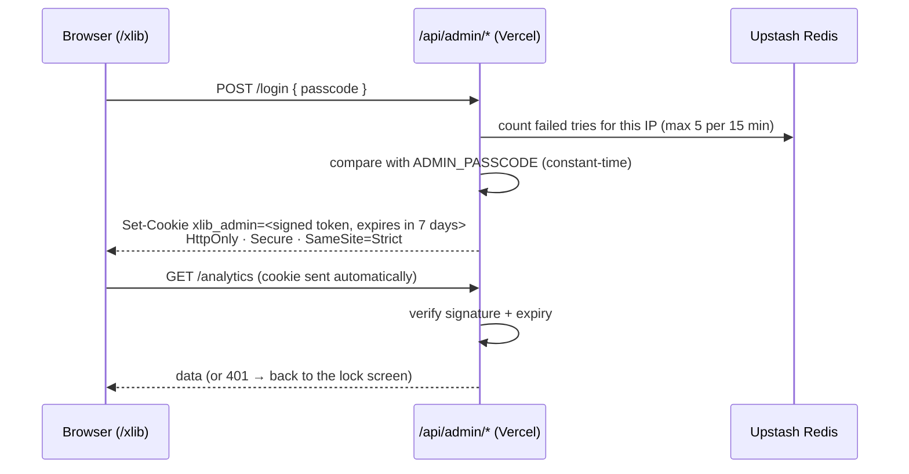
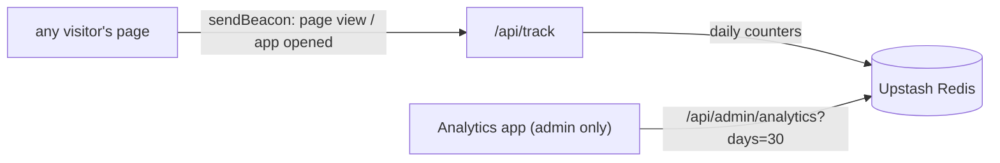

# Admin mode (`xlibraries.com/xlib`): plan

The same desktop, opened at `/xlib`, with a passcode on the lock screen. After login, admin-only apps appear
on the desktop. Visitors at `/` see no difference.

## How login works

- The passcode exists only as a Vercel environment variable (`ADMIN_PASSCODE`); it's never in the site's code.
- The session is a token signed with `ADMIN_SESSION_SECRET`; JavaScript can't read the cookie, and it expires
  after 7 days (like your Google re-authorization).
- Admin requests must come from xlibraries.com (`Origin` check) and the cookie is `SameSite=Strict`, so other
  sites can't act as you. `/xlib` is marked `noindex`.

## Analytics, on your own site

- Counts per day: page views, unique visitors (estimated with a HyperLogLog of a daily-salted hash; no IPs
  or cookies stored), app opens, countries (Vercel's geo header), referrers, and screen size.
- Bots and your own logged-in visits are left out.
- Google Analytics and Vercel Analytics are removed (one fewer script, no tracking cookies, simpler security
  policy).
- Built as a package, `@xlibraries/analytics` (tracker, recorder with a storage interface, dashboard), like
  the other apps.

## Phases (one PR each)

| | What you get | Needs from you |
| --- | --- | --- |
| **1. Login + Analytics** ✅ | `/xlib`, passcode lock screen, Analytics app (visits per day, top apps, countries, referrers) | Add Upstash Redis in Vercel; set `ADMIN_PASSCODE`, `ADMIN_SESSION_SECRET` |
| **2. Photo Drop status** ✅ | Recent uploads, and a warning when Google access is about to expire (with a "how to re-authorize" link) | Nothing: I deploy the Apps Script change with `pnpm deploy:photo-drop` |
| **3. Site switches** ✅ | Live toggles without a deploy: Photo Drop open/closed, show/hide apps, a banner message | Nothing |
| **4. Edit content** | Edit About / Side Quests / terminal text from the desktop; saved as a GitHub commit, so Vercel redeploys | A GitHub fine-grained token (this repo, contents: write) in Vercel |

## Setup for phase 1 (about 5 minutes, in Vercel)

1. **Vercel → your project → Storage → Create Database → Upstash for Redis** (free plan) → connect it to the
   project. This adds `KV_REST_API_URL` and `KV_REST_API_TOKEN` automatically.
2. **Settings → Environment Variables**, for Production and Preview:
   - `ADMIN_PASSCODE`: the passcode you'll type on the lock screen (different from Photo Drop's)
   - `ADMIN_SESSION_SECRET`: a long random string, e.g. the output of `openssl rand -hex 32`
3. For local development, put the same four values in `apps/web/.env.local` (git ignores it).

Until those exist, the site keeps working: tracking quietly does nothing and `/xlib` says admin isn't set up.
