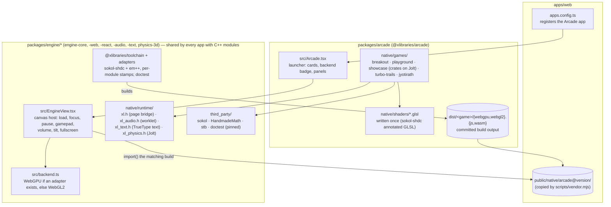
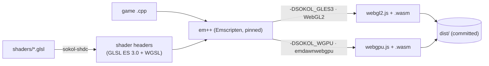

# Arcade: plan

An **Arcade** app on the desktop that runs real-time graphics written in C++ with
[sokol](https://github.com/floooh/sokol), compiled to WebAssembly. Every experience is built twice, for
**WebGPU** and **WebGL2**, and the app picks the best one the visitor's browser supports.

First three experiences: a **neon arcade game**, a **shader playground** and a **3D showcase**; then
**Turbo Trails**, a full game ([turbo-trails-plan.md](turbo-trails-plan.md)), and **JyotiRath**, its story in 3D
([jyotirath-plan.md](jyotirath-plan.md)).

## How it fits together

## Build pipeline

- **`pnpm --filter @xlibraries/arcade build:native`** runs it (a Node script calling `sokol-shdc` and `em++`;
  no CMake). It needs the Emscripten SDK locally; Vercel doesn't, because the output is committed.
- **CI** installs the same pinned Emscripten and `sokol-shdc`, rebuilds everything, and fails if the result
  differs from what's committed (so `dist/` can't drift from the sources). Builds use flags that keep the
  output reproducible (e.g. `-ffile-prefix-map`).
- Shaders are written **once** and cross-compiled for both backends. The only exception is the shader
  playground's live editor, which compiles your code at runtime: GLSL on WebGL2, WGSL on WebGPU.
- Game logic that doesn't need a GPU (collisions, physics, scoring) is also compiled natively and unit-tested
  with [doctest](https://github.com/doctest/doctest) in CI.

## Living in a desktop window

| Concern | How |
| --- | --- |
| Several games open at once | Each window instantiates its own WebAssembly module (Emscripten `MODULARIZE`), with its own canvas |
| Typing in the terminal while a game is open | Keys reach a game only while its window is focused (the page tells the runtime) |
| Minimized or hidden window | The page pauses the game; no frames, no audio |
| Closing the window | The module shuts down and its canvas and GPU resources are released |
| Fullscreen | Button in the window; the canvas follows the window's size |
| Sound | `xl_audio.h`: an AudioWorklet (`xl-audio-worklet.js`, copied beside each build) fed from the game's mixer through a GainNode the desktop's volume slider drives (`host.volume` → `Module.xlSetVolume`); starts on the first click, as browsers require |
| Haptics | `xl::rumble(strong, weak, ms, touch)`: a gamepad's `vibrationActuator`, and `navigator.vibrate` when playing by touch |
| High scores | Saved in the visitor's browser through the bridge |
| Security policy | Adds `'wasm-unsafe-eval'` (needed to run WebAssembly), nothing else; builds avoid `eval` (`-sDYNAMIC_EXECUTION=0`) and load only from this site |

## The three experiences

1. **Neon Breakout**: paddle, bricks, particles and glow, sound effects, levels and a saved high score. Proves
   input, 2D rendering, audio and saving.
2. **Shader Playground**: full-window fragment shaders with presets (plasma, tunnel, raymarched scene) and an
   editor for writing your own, recompiled live; errors shown inline.
3. **3D Showcase**: an orbitable, lit low-poly diorama, procedurally generated (terrain, a winding road, a car
   driving it, day/night), the groundwork for 3D games.

## Phases (one PR each)

| | What you get |
| --- | --- |
| **1. Foundation** ✅ | Package, pinned sokol and toolchain, build script, CI rebuild check, the runtime bridge, the Arcade app with one tiny animated scene running on both backends, CSP update, e2e tests for both backends |
| **2. Neon Breakout** ✅ | The game, sound, high scores, native unit tests for its logic |
| **3. Shader Playground** ✅ | Presets, live editor, error reporting |
| **4. 3D Showcase** ✅ | The diorama, orbit camera, day/night |

## Setup

Nothing in Vercel. For local builds, I install the Emscripten SDK into `~/emsdk` (pinned version, about
1 GB) and `sokol-shdc` is downloaded by the build script. Without them you can still run and test the site,
because the built files are committed.
