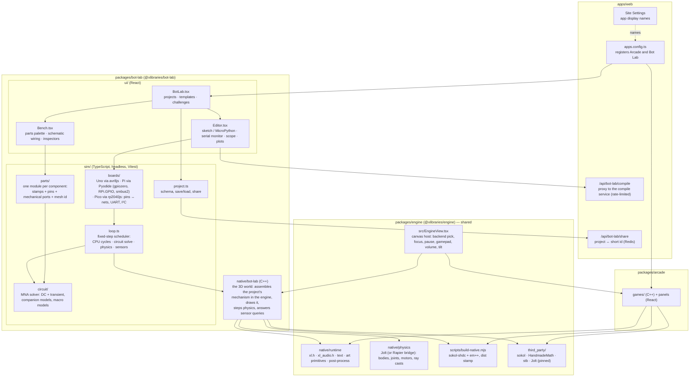

# Bot Lab: plan

A **Bot Lab** app on the desktop: an electronics and robotics simulator where you build whatever you like from
real-world parts (an Arduino Uno, a Raspberry Pi, servos, gearmotors and drivers, BLDC motors and ESCs, sensors,
resistors, capacitors, gears, wheels, arms, propellers), wire them on a bench, run **real code** (Arduino C++ on an
emulated ATmega, Python with `gpiozero`/`RPi.GPIO` on a Raspberry Pi), and watch the result run in a physical 3D
world. Templates and challenges (a line
follower on a track, a pick-and-place arm at a conveyor, a quadcopter over a pad) show the way; the sandbox is the
point.

Two things make it more than a toy: the electronics are simulated down to the circuit (a modified-nodal-analysis
solver, so a resistor, a capacitor, a diode, a divider and a motor's back-EMF all behave), and the code is the real
thing (a sketch on an emulated chip, a Python script with the real Pi libraries), so what works here works on the
bench.

## Decisions (confirmed)

| # | Decision | Notes |
| --- | --- | --- |
| 1 | **Code is real**: Arduino sketches compiled to AVR and run on an emulated ATmega328P (`avr8js`, MIT); Raspberry Pi programs are Python 3 running on CPython in the browser (Pyodide) with the Pi libraries (`gpiozero`, `RPi.GPIO`, `smbus2`, `pigpio`, a `picamera` stub) reimplemented over the simulated nets | AVR needs a compiler: a small **compile service** (Docker: `arduino-cli` + the AVR core) on **Cloud Run** behind `/api/bot-lab/compile`, rate-limited; templates ship with **precompiled `.hex`** committed, so the app runs without the service. Python needs no compiler. See "The Raspberry Pi" below for why this and not a hardware emulator. |
| 2 | **One engine for the repo**: rendering in C++/sokol, physics in **Jolt** (C++, MIT), as an independent package the Arcade and Bot Lab both use | `packages/engine` (`@xlibraries/engine`): today's `native/runtime`, the build pipeline, the vendored libraries, the React canvas host, plus Jolt compiled into the same WebAssembly module as sokol: one build, one memory, no Rust toolchain. |
| 3 | **Boards in v1: both**: Arduino Uno (AVR) and Raspberry Pi (Python, Linux-style) | Plus the Raspberry Pi Pico (`rp2040js` running MicroPython) as a cheap extra, since it costs little once the AVR path exists; drop it if you'd rather keep the list short. |
| 4 | **Free building** from the parts library; templates and challenges are examples, not the only paths | Any combination that's electrically valid runs; the physics takes whatever mechanism you assemble. |
| 5 | **Saving: this device + share links**; accounts later ([#53](https://github.com/xlibraries/Xlib/issues/53)) | localStorage + JSON export/import; share links store the project in Redis under a short id (`/api/bot-lab/share`). |
| 6 | **Challenges and free play** | Each template carries a goal and a timer; free play has neither. |
| 7 | **Name: `bot-lab`** for now, renamed later from the admin panel | App display names become a Site Settings field (`/xlib`), so this and any app can be renamed without a deploy. |
| 8 | **Circuit-level electronics from the start**, not only behavioural parts | A modified-nodal-analysis (MNA) solver, Falstad-style, in TypeScript: DC and transient, companion models for C/L/diodes/transistors, with complex parts (boards, motors, servos, drivers) as **macro models** that stamp into the same matrix (a DC motor is R + L + a back-EMF source + a mechanical port to the physics). Rules that teach (polarity, two outputs on one net, a motor on a logic pin, sag and cut-off, overload = magic smoke) fall out of the solver instead of being special cases. |

### The Raspberry Pi

A hardware-level emulation (QEMU's `raspi3` machine compiled to WebAssembly booting Raspberry Pi OS) exists as an
experiment, and it's the wrong tool here: a 400–800 MB image, a boot measured in minutes, and a CPU far too slow to
drive a robot at real time. What people *do* with a Pi on a robot is run Python on Linux against the GPIO. So the
Pi in Bot Lab is that:

- **CPython 3 in the browser** (Pyodide, ~10 MB, loaded once when a project first uses a Pi, then cached) in a Web
  Worker; the standard library, `numpy` if wanted.
- **The real Pi libraries**, reimplemented on the simulated nets with the same API: `gpiozero` (`LED`, `Button`,
  `Servo`, `Motor`, `Robot`, `DistanceSensor`, `LineSensor`), `RPi.GPIO`, `smbus2`/`smbus` (I²C: the IMU's register
  map answers), `pigpio` (hardware PWM, waveforms), `serial`, a `picamera2` stub that returns a render of the
  world's camera. A script that runs here runs on a real Pi unchanged.
- **A Pi-flavoured terminal** in the app (the site's terminal package): `python3 robot.py`, `ls`, `nano`-ish
  editing via the editor, `gpio readall`, `i2cdetect -y 1`, a `/home/pi` with the project's files.
- **Time is simulated**: `time.sleep`, `time.monotonic` and `gpiozero`'s background threads follow the simulation
  clock, so a script behaves the same at any frame rate and can be single-stepped with the rest of the world.
  (`gpiozero`'s threaded helpers such as `blink()` and `when_pressed` run on the simulation's scheduler, serviced
  while the script sleeps; Pyodide has no real threads.)
- **The board**: 3.3 V logic on the 40-pin header (BCM numbering, the pins people use: GPIO2–27, 3V3, 5V, GND),
  ~16 mA per pin, pull-ups/downs on request, software PWM at the frequency the library asks for (100 Hz LEDs,
  50 Hz servos). No ADC, as on the real board: an MCP3008 over SPI comes with the sensors.
- Not in scope: C programs on the Pi, the desktop, networking. (Those can come as `wiringPi`-style shims later if
  wanted.)

### The runtime: a worker, and Python that suspends

The bench, the emulated boards and the Pi's Python all run off the main thread, in a Web Worker, so the page stays
smooth. The app talks to it with `postMessage` (load project, run, stop, set a prop, send serial) and the worker
streams snapshots back (time, part states, net voltages, serial lines, Python output, warnings) about 30 times a
second. The same runtime serves the Uno and the Pi; the unit tests keep driving `Bench` directly.

Python's `time.sleep()` runs the bench for that long, and a script must keep to real time, hear button presses and
stop mid-sleep. With **JSPI** (WebAssembly stack switching, in Chromium browsers) a sleep advances the bench and then
suspends Python on a timer until the wall clock catches up; the worker's event loop runs meanwhile, so messages
arrive. Without JSPI the script runs synchronously with busy-wait pacing, inputs wait until it ends, and Stop
replaces the worker. A `SharedArrayBuffer` stop word was the first design, but it needs cross-origin isolation, which
the desktop can't have (the Music app embeds YouTube) and which a frame can't have unless its embedder does.

### The compile service (Cloud Run) ✅ (see services/arduino-compiler/README.md)

- `services/arduino-compiler/`: a Dockerfile with `arduino-cli` and the `arduino:avr` core pinned; an HTTP endpoint
  `POST /compile { fqbn, sketch, libraries } → { hex, errors[] }` with a shared-secret header, a 20 s timeout and
  a 64 KB sketch limit.
- Deployed by a GitHub Action on changes to that folder (`gcloud run deploy`, min instances 0 so it costs nothing
  idle). From you: a GCP project with Cloud Run and Artifact Registry enabled, a deploy service-account key in the
  repo's secrets, and `BOT_LAB_COMPILER_URL` + `BOT_LAB_COMPILER_SECRET` in Vercel.
- The site's `/api/bot-lab/compile` proxies to it with a per-IP rate limit (like the leaderboard's) and never
  exposes the secret; the editor caches the last successful hex per project. Without the service, the committed
  template hexes and the Pi (no compiler needed) keep the app usable.

### Arcade migration

Moving the runtime and build script into `packages/engine` is a refactor of the Arcade with no visible change; it
lands first (phase 1) so both apps build on the same thing.

## How it fits together



## The simulation loop

```mermaid
sequenceDiagram
    participant CPU as Board (avr8js · Pyodide worker · rp2040js)
    participant C as Circuit (MNA, TypeScript)
    participant W as World (C++: Jolt + sokol)
    loop every 1/240 s
        CPU->>C: pin states, PWM duties, I²C/UART traffic (cycle-accurate within the step)
        C->>C: solve the nets (DC or transient step); macro models update
        C->>W: motor torques, servo targets, propeller thrust (one float array over the WASM boundary)
        W->>W: step rigid bodies, joints, contacts
        W->>C: poses, joint angles/speeds, ray casts (sensors), contacts (switches)
        C->>CPU: analog voltages, digital levels, I²C replies (IMU, encoders)
    end
```

- **One clock.** The AVR runs 16 MHz ÷ 240 = 66 666 cycles per step; the RP2040 likewise at its clock; the Pi's
  Python runs in a worker whose `time` module and `gpiozero` threads are driven by the simulation clock (the
  worker blocks on each `sleep` until the loop reaches that time). `delay()`, `millis()`, `time.sleep()` therefore
  behave the same at any frame rate, in a background tab, or stepping. Fast-forward is more steps per frame; a
  stalled tab never desyncs.
- **Headless `sim/`.** Tests build a project, run N seconds, and assert on nets, pins and poses: "this divider reads
  2.5 V", "this RC settles in 5τ", "this sketch's PWM duty is 50 %", "the follower stays within 2 cm of the line",
  "the gripper lifts the cube", "the quad holds 1 m". The C++ world is tested natively (doctest) like Turbo
  Trails' rules; the two meet in Playwright.
- **Determinism**: emulators and the physics engine are deterministic for a given build, so a challenge run is
  replayable from the project + firmware image, which a later leaderboard can verify server-side.

## The circuit solver

- **MNA** with Newton–Raphson for non-linear elements and trapezoidal/backward-Euler companions for C and L (the
  Falstad/ngspice recipe), solved per electrical tick; nets with only digital drivers skip the matrix.
- **Elements**: wire, resistor, potentiometer, capacitor, inductor, diode/LED, BJT/MOSFET (Ebers–Moll / level-1),
  voltage and current sources, switch/button, op-amp (ideal), voltage regulator (macro).
- **Macro models** for the bench parts: battery (EMF + internal resistance + capacity), DC gearmotor (R, L,
  back-EMF ∝ ω, torque ∝ I, gear ratio to the mechanical port), servo (logic pin → target, current ∝ load),
  driver (H-bridge from logic pins with a voltage drop), BLDC + ESC (throttle → RPM → thrust/torque, current ∝
  thrust), sensors (resistive IR, ultrasonic timing, I²C IMU register map), board pins (push-pull outputs with
  source/sink limits, inputs with pull-ups, ADC).
- **Teaching rules** come from the numbers: current over a pin's limit, a net with two push-pull drivers in
  disagreement, reverse polarity on an electrolytic or LED, power over a part's rating (smoke, part marked dead
  until replaced), battery sag under motor stall, brown-out resets on the board.
- **Instruments**: multimeter probe on any net, oscilloscope on up to four nets, serial monitor, plots of any pin or
  mechanical quantity.

## The parts library (v1)

| Group | Parts |
| --- | --- |
| Boards | Arduino Uno (ATmega328P), Raspberry Pi (Python 3, 40-pin header, I²C/SPI/UART/PWM), Raspberry Pi Pico (RP2040) |
| Power | 2S Li-ion pack, AA ×4, 9 V battery, 5 V regulator, barrel jack, USB power |
| Passives and bench | breadboard, wires, resistors, capacitors, inductor, diode, LEDs, buzzer, push button, switch, potentiometer, BJT, MOSFET, op-amp |
| Drive | SG90 and MG996R servos, N20 and TT gearmotors, L298N and TB6612 drivers, 28BYJ stepper + ULN2003, 2204 BLDC + 20 A ESC |
| Mechanics | chassis plates, wheels and casters, gearboxes (ratio), shafts, arm links, gripper, propellers, quad frame, conveyor, track pieces, cubes and pads |
| Sensors | IR reflectance array (QTR-8), HC-SR04 ultrasonic, MPU6050 IMU, quadrature encoder, limit switch, LDR, TMP36 |

Each part is one TypeScript module (`spec`, `pins`, `stamp()`, mechanical `ports`, `meshId`) and, when it has a
body, one C++ mesh/collider description in the world. Adding a part never touches the loop or the solver.

## Templates and challenges

| Template | Shows | Challenge |
| --- | --- | --- |
| Blink · Button · Divider · RC | the bench, the scope, the solver | none (free play) |
| Servo sweep (Uno) · Servo sweep (Pi, `gpiozero`) · Servo sweep (Pico, MicroPython) | the boards, PWM | none |
| **Line follower** | gearmotors + driver, IR array, a track you draw | finish the track under 40 s, never off the line for more than 1 s |
| **Pick-and-place arm** | servo joints, gripper, conveyor | move five cubes to the bin |
| **Quadcopter** | BLDC + ESC, IMU over I²C, PID with live gains | take off, hover 10 s within 20 cm, land on the pad |

## Living in the desktop

- A package app like the others (`{ host }`: `volume`, `track`, `openApp`), the engine's `EngineView` hosts the
  world; the bench, editor and instruments are React around it. Phones: world full-width, the panel as a sheet.
- Projects: `bot-lab:projects` in localStorage, JSON export/import, share links.
- Nothing external at runtime except the compile proxy when you build an Arduino sketch (and even that falls back
  to the committed template hexes). Libraries vendored: `avr8js`, `rp2040js`, the MicroPython UF2 (pinned), Pyodide
  (pinned, served from `public/vendor/` like Leaflet and pdf.js), Jolt (pinned source, built into the engine's wasm).

## Phases (one PR each)

| | What you get |
| --- | --- |
| **0. Plan** | This document; sizes measured (Jolt wasm, Pyodide, rp2040js + MicroPython); the Cloud Run project set up |
| **1. The engine package** ✅ | `packages/engine`: runtime, build pipeline with the dist stamp, third-party, `EngineView`; the Arcade moved onto it with no visible change; CI rebuilds both |
| **2. Physics in the engine** ✅ | Jolt v5.6.0 vendored and compiled into physics modules' wasm; `xl_physics.h` (bodies: box/sphere/capsule/cylinder/mesh/height field; hinges and sliders with velocity and position motors; ray casts; contacts; deterministic) with doctest coverage; the Arcade's 3D showcase uses it: a kinematic car knocks a pyramid of crates down the island's height field |
| **3. The bench and the solver** ✅ | `packages/bot-lab`: `sim/circuit/mna.ts` (MNA, backward Euler, Newton for diodes), parts (Uno, battery, resistor, capacitor, LED, button, potentiometer, LDR, servo), the bench loop at 4.8 kHz with the Uno on avr8js (pin modes, PWM duty, pulse widths, ADC, serial), rules (burnt LEDs, overloaded pins), templates with committed hexes (Blink, Button, Servo sweep, Hello serial, RC), the bench UI (drag parts, click pins to wire, inspector, code, serial monitor, multimeter), projects on this device. Instruments beyond the multimeter (scope) and the remaining parts come with later phases |
| **4a. The Raspberry Pi** ✅ | The runtime worker that runs the bench for both boards and streams snapshots to the app; `boards/pi.ts` (40-pin header, 3.3 V logic, pulls, software PWM and servo pulses); Python on Pyodide (pinned, vendored) with Bot Lab's `gpiozero` (LED, PWMLED, Button with callbacks, Servo, AngularServo, Motor, Robot, pause) and `RPi.GPIO` over the nets, `time.sleep` advancing the simulation (no threads: blinks and button watchers run on a scheduler serviced while the script sleeps), with JSPI a sleep suspends Python until the clock catches up, so button presses and Stop arrive mid-sleep (without it: busy-wait pacing, and Stop restarts the worker); Pi templates (Blink, Button, Servo sweep); the console in the Monitor tab |
| **4b. Live builds** ✅ | `services/arduino-compiler/server.py`: an HTTP front on the pinned compiler image (shared secret, 64 KB / 45 s limits, compiles as an unprivileged user so a sketch can't `#include` the secret, core precompiled into the image); deployed to Cloud Run by `.github/workflows/arduino-compiler.yml` with Workload Identity Federation (no keys) after the one-time `setup-gcp.sh`; `/api/bot-lab/compile` with a per-visitor limit and a cache by sketch; the editor's Build button, with flash usage, warnings, errors that jump to their line, and a note when the sketch changed since its build |
| **4c. More boards and libraries** | `smbus2`/`pigpio` and the Pi terminal; the Pico via rp2040js + MicroPython with a REPL |
| **5. Mechanisms and the line follower** | The C++ world: assembling a project's mechanism (chassis, wheels, gears, motors as joints), sensors by ray cast, the track editor; the line-follower template and challenge |
| **6. Arm and conveyor** | Servo joints with torque limits, gripper contacts, cubes, conveyor; the pick-and-place template and challenge |
| **7. Flight** | BLDC/ESC/propeller thrust and torque, IMU with noise, wind; PID template with live gains and plots; the quadcopter challenge |
| **8. Sharing and names** | Share links in Redis, replays, a challenge leaderboard verified by re-running; app display names in Site Settings |

## Risks and how they're handled

- **Emulation speed**: avr8js runs an ATmega at real time with headroom on a phone; Python on Pyodide is fast
  enough for GPIO scripts (they mostly sleep); rp2040js running MicroPython is close to real time on desktop,
  slower on phones (a "slow motion" badge, never a frozen tab: the loop budgets cycles per frame and the clock
  follows).
- **Pyodide's 10 MB** loads only for projects with a Pi, once, from our own `/vendor/` (cached by the browser).
- **The compile service is a dependency**: it's optional by design (committed hexes, MicroPython needs nothing),
  rate-limited and stateless, with the Docker image in the repo so it can move hosts.
- **Solver stiffness**: inductors and ideal switches can make the matrix stiff; backward Euler on switching nets
  and small ticks keep it stable, and every element has a test against its analytic answer.
- **Bundle size**: the engine wasm with Jolt (~1.5 MB) and the emulators load only when Bot Lab opens.
- **Scope**: parts beyond the table wait until the three challenge templates run end to end.
