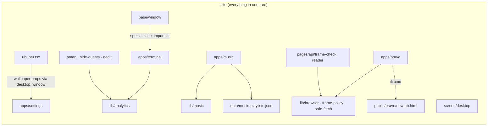
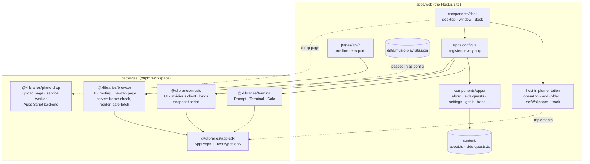
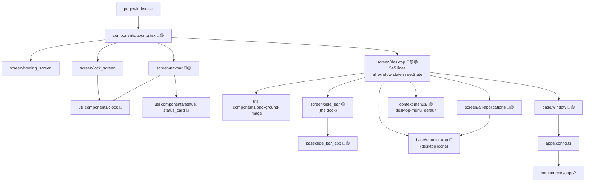
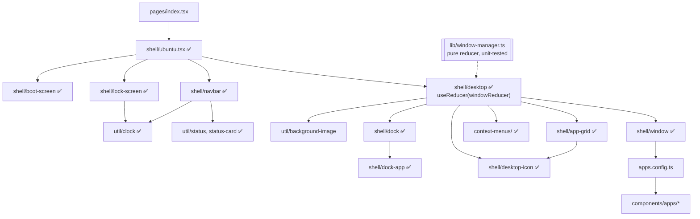
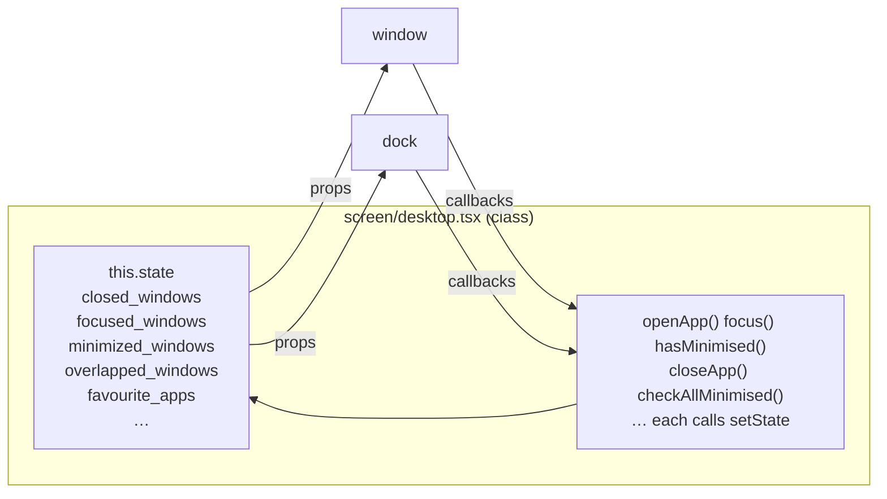
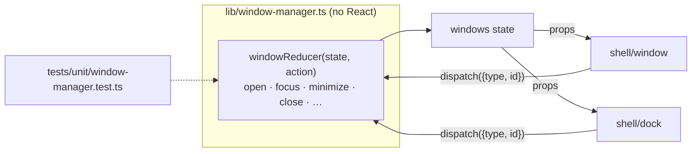
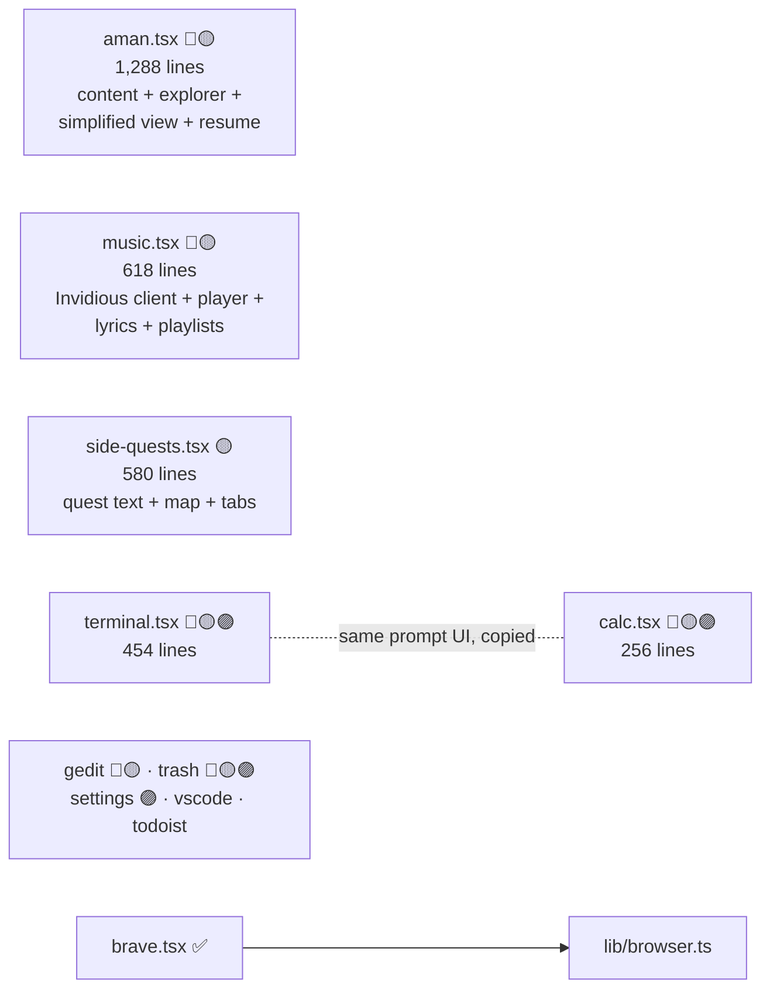
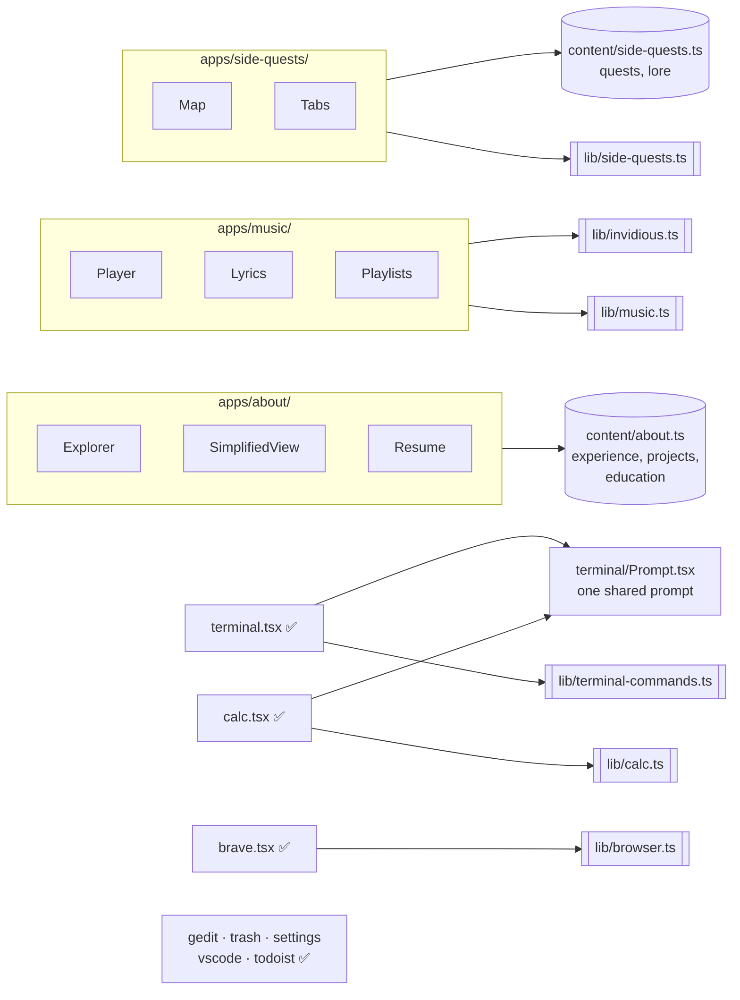
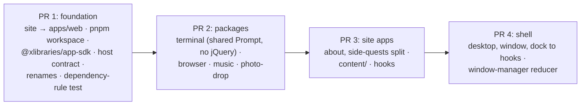

# Restructuring plan: current vs proposed

Legend: 🔴 class component · 🟡 `@ts-nocheck` · 🟣 jQuery · ✅ hooks, typed, tested

## 0. Packages (revised plan)

The bigger apps become **self-contained packages** in a pnpm workspace. Each package owns everything it
needs (UI, logic, server code, static pages, scripts, tests, README) and imports nothing from the site, so it
can later move to its own repo and come back as a **git submodule** in `packages/` or as a **published pnpm
package**, without changing a line of the site.

### Coupling today



### Proposed: packages talk to the site through one small contract



**Rules** (checked by a test, so they can't erode):

| From → To | Allowed? |
| --- | --- |
| site → any package | ✅ |
| package → `@xlibraries/app-sdk` | ✅ |
| package → site (`../../lib`, `components/`, `data/`) | ❌ |
| package → another app package | ❌ |

**The contract** (`@xlibraries/app-sdk`, types only, no runtime code):

```ts
export interface Host {
    openApp(id: string): void;
    addFolder(name: string): void;          // terminal's mkdir
    setWallpaper(name: string): void;       // settings
    track(event: { category: string; action: string; label?: string }): void;  // analytics, no-op if off
}
export interface AppProps { host: Host }
```

Every app gets `host` the same way, so `window.tsx` loses its Terminal special case and the wallpaper
props stop being threaded through three components.

### Repo layout

```
Xlib/
├─ package.json            workspace root: scripts that run across everything (verify, lint, test)
├─ pnpm-workspace.yaml     apps/*, packages/*
├─ apps/
│  └─ web/                 the Next.js site (today's repo root: pages, components, public, content, e2e tests)
├─ packages/
│  ├─ app-sdk/             @xlibraries/app-sdk
│  ├─ browser/             @xlibraries/browser
│  ├─ music/               @xlibraries/music
│  ├─ terminal/            @xlibraries/terminal
│  └─ photo-drop/          @xlibraries/photo-drop (static page + backend/ Apps Script)
├─ docs/                   architecture, this plan
└─ .github/, .githooks/    CI and the pre-commit hook (run the root verify)
```

**Vercel**: the project's *Root Directory* changes to `apps/web` (one setting in Vercel → Project →
Settings → Build and Deployment). It has to be switched at the moment PR 1 merges, since it applies to every
branch.

### Inside a package

```
packages/browser/
├─ package.json        name @xlibraries/browser · peerDependencies react · exports ".", "./server"
├─ README.md           what it is, how to use it in another site
├─ src/
│  ├─ Browser.tsx      the app (default export, takes AppProps)
│  ├─ routing.ts       today's lib/browser.ts
│  └─ server/          frame-check, reader, safe-fetch, frame-policy
├─ public/newtab.*     static files, copied into the site's public/ on install/build
└─ tests/              its own unit tests (run by the root vitest as a project)
```

- **No build step**: packages ship TypeScript source; the site compiles them via Next's `transpilePackages`.
- **Static files**: the existing `scripts/vendor.mjs` also copies each package's `public/` folder into the site.
- **e2e tests** stay in the site (they test the assembled desktop).
- **Moving one out later**: `git subtree split` the folder into its own repo, then either
  `git submodule add <repo> packages/browser` (the workspace keeps working as is) or publish it and change
  `"@xlibraries/browser": "workspace:*"` to a version number.

### Which apps become packages

| Package | Why |
| --- | --- |
| `@xlibraries/browser` | Big, generic, has server code and a static page; useful on any site. |
| `@xlibraries/music` | Big and generic; the playlists stay in the site and are passed in. |
| `@xlibraries/terminal` | Terminal and Calc share the prompt; generic. |
| `@xlibraries/photo-drop` | Already standalone: static page, service worker, Apps Script backend, its own tests. |

About Aman and Side Quests stay in the site: they're your personal content, not reusable apps. Their logic
still goes to `lib/` and their text to `content/`.

## 1. Component tree

### Current



### Proposed



## 2. Window state

### Current: state and logic mixed into one class



### Proposed: one pure reducer, components only dispatch



## 3. Apps

### Current



### Proposed



`[[ ]]` = pure logic in `lib/` with unit tests · `[( )]` = your written content as typed data

## 4. Folder layout

| Now | Proposed |
| --- | --- |
| `components/ubuntu.tsx` | `components/shell/ubuntu.tsx` |
| `components/screen/desktop.tsx` | `components/shell/desktop.tsx` |
| `components/screen/navbar.tsx` | `components/shell/navbar.tsx` |
| `components/screen/booting_screen.tsx` | `components/shell/boot-screen.tsx` |
| `components/screen/lock_screen.tsx` | `components/shell/lock-screen.tsx` |
| `components/screen/side_bar.tsx` | `components/shell/dock.tsx` |
| `components/screen/all-applications.tsx` | `components/shell/app-grid.tsx` |
| `components/base/window.tsx` | `components/shell/window.tsx` |
| `components/base/side_bar_app.tsx` | `components/shell/dock-app.tsx` |
| `components/base/ubuntu_app.tsx` | `components/shell/desktop-icon.tsx` |
| `components/util components/*` | `components/util/*` (kebab-case) |
| `components/context menus/*` | `components/context-menus/*` |
| `components/apps/aman.tsx` | `components/apps/about/*` + `content/about.ts` |
| `components/apps/music.tsx` | `components/apps/music/*` + `lib/invidious.ts` |
| `components/apps/side-quests.tsx` | `components/apps/side-quests/*` + `content/side-quests.ts` |
| Terminal and Calc prompt code (twice) | `components/terminal/Prompt.tsx` + `lib/terminal-commands.ts`, `lib/calc.ts` |

Element ids the e2e tests and users rely on (`#sidebar-…`, `#terminal`, `#about-aman` …) stay the same.

## 5. Scorecard

| | Now | Proposed |
| --- | --- | --- |
| Files skipping type checks | 16 | 0 |
| Class components | 15 | 0 |
| Files using jQuery | 5 | 0 (dependency removed) |
| Largest component | 1,288 lines | about 300 |
| Copies of the terminal prompt | 2 | 1 |
| Window logic with unit tests | none | all of it |

## 6. Delivery



Each PR passes `pnpm verify` (all 43 e2e tests stay green) and CI before it's merged.
