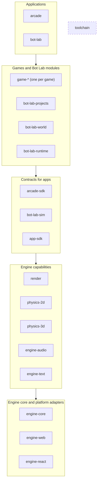

# Streams plan: engine, Arcade, Bot Lab (current vs proposed)

> **Status: phases 0 and 1 done; progress is tracked in [MIGRATION.md](../MIGRATION.md).** The toolchain landed in
> `packages/tooling/` rather than `packages/engine/`: it's layer 0 and serves more than the engine. Each phase below is
> one PR with `pnpm verify` green.

## 0. The principle

**Every core component is an independently versioned, buildable, testable and releasable package.** A package:

1. owns its implementation and its public API;
2. declares every dependency explicitly, with a version;
3. never reaches into another package's internal source (headers or TypeScript);
4. never needs another package's source changed to work;
5. can be used without importing the application it was written for;
6. can be replaced without changing unrelated consumers;
7. has its own build, test and release lifecycle.

Priorities, in order: **modularity** (own source, tests, build config), **scalability** (a new game, renderer,
physics backend or simulator module never edits an existing package), **independence** (develop, test, build,
version, release alone), **explicit dependencies** (stable public APIs only).

Dependencies are fine; hidden coupling isn't. `render → engine-core` is fine. `game-jyotirath →
game-turbo-trails` never is.

## 1. Current structure

```
packages/
  engine/       @xlibraries/engine: platform runtime (xl.h, audio, text, colour) + Jolt physics (xl_physics)
                + build/test tooling + React host (EngineView, backend, gamepad), versioned together
  arcade/       @xlibraries/arcade: the Arcade app + all six games + Box2D + JyotiRath's renderer (mesh.*, the
                lit pipeline in main.cpp); one shaders folder, one native test binary, one dist, one stamp
  bot-lab/      @xlibraries/bot-lab: UI + simulator + worker runtime + native world and view + python shims
                + firmware + templates, one package
  app-sdk/      @xlibraries/app-sdk: the desktop ↔ app contract (AppProps, Host)
services/arduino-compiler/        already separate
apps/web/                         depends on every package as workspace:^; vendor.mjs serves arcade dist at
                                  /arcade and bot-lab dist at /vendor/bot-lab
```

What's tangled:

1. **One stamp per package over the whole engine.** Editing JyotiRath fails verify until all six games are
   rebuilt; any engine edit rebuilds every game and Bot Lab.
2. **No shared renderer.** JyotiRath's mesh builder, PBR shading, shadows, MSAA and post pass live inside the game;
   Showcase and Bot Lab's view each have their own.
3. **Physics in two places.** Jolt in the engine, Box2D inside the Arcade, and Jolt's types visible to callers.
4. **The engine is four things** (platform, physics, tooling, React host) with one version.
5. **The Arcade is one package of six games:** one test binary (symbols can collide), a hard-coded game list,
   game panels in the Arcade's `src/`.
6. **Bot Lab is one package of five concerns** (UI, simulator, runtime, world, projects).
7. **Everything is `workspace:^`.** Any local change reaches every consumer at once: there is no version isolation.
8. **Two serving conventions**, and adding a native module means editing the site.
9. **One CI job** rebuilds everything on any change.

## 2. Proposed packages

Layers, top to bottom. A package may depend on packages in layers **below** it, never upwards. Within a layer,
only the declared engine edges in the table are allowed (e.g. `engine-web → engine-core`); games never depend on
games, and Bot Lab modules never on each other. The graph is acyclic. The toolchain is a dev dependency only,
outside the graph.



| Package | Layer | Owns (public API) | Depends on |
| --- | --- | --- | --- |
| `engine-core` | 1 | the platform contract: app lifecycle, frame timing, input (keys, pointer, gamepad state), focus, save/load, logging | — |
| `engine-web` | 1 | the browser/WASM adapter for `engine-core`: sokol_app + Emscripten glue, backend choice (WebGPU/WebGL2), the audio worklet bridge | engine-core |
| `engine-react` | 1 | `EngineView`: loading a module into a canvas, lifecycle, focus, backend fallback. React lives **only** here | engine-web (JS side) |
| `engine-audio` | 2 | voices, mixing, `xl_audio` | engine-core |
| `engine-text` | 2 | font baking, text layout and drawing; ships the primary font (Lilita One) as the default, and lets a game register its own fonts alongside it | engine-core |
| `render` | 2 | Mesh, MeshBuilder (primitives, wobble, AO), Material, Camera, Lighting, RenderTarget, RenderPipeline (shadow pass, MSAA scene, resolve), PostProcess (tilt-shift, bloom, grade); its shaders. sokol types never appear in its public headers | engine-core |
| `physics-2d` | 2 | World2D, Body2D, Collider2D, Contact2D, Raycast2D; **Box2D behind it** | — |
| `physics-3d` | 2 | World3D, Body3D, Collider3D, Joint, Contact3D, Raycast3D; **Jolt behind it** | — |
| `app-sdk` | 3 | (exists) the desktop ↔ app contract: AppProps, Host | — |
| `arcade-sdk` | 3 | GameInfo, PanelProps, the game manifest type | app-sdk |
| `bot-lab-sim` | 3 | pure TypeScript, no React, no DOM: circuit (MNA), parts, boards (Uno, Pi, Pico), I²C, bench, the project and challenge formats | avr8js, rp2040js |
| `game-<id>` | 4 | one game: native code, shaders, tests, dist, card, optional panel, manifest | engine-*, render, physics-*, arcade-sdk |
| `bot-lab-runtime` | 4 | the worker, protocol, Pi on Pyodide, Python shims, firmware | bot-lab-sim, pyodide |
| `bot-lab-world` | 4 | the headless world and its 3D view | engine-*, render, physics-3d |
| `bot-lab-projects` | 4 | templates (sketches + compiled hexes), challenges, the generated bundle | bot-lab-sim |
| `arcade` | 5 | the Arcade app: launcher, cards, canvas, panels host, leaderboard client. Knows no game by name | engine-react, arcade-sdk, app-sdk |
| `bot-lab` | 5 | the Bot Lab app: UI, plot, compile client; wires the modules | bot-lab-*, engine-react, app-sdk |
| `toolchain` | dev | the build graph, stamps, cache and the adapters (see §5) | — |

Folders: `packages/engine/{core,web,react,audio,text,render,physics-2d,physics-3d,toolchain}`,
`packages/arcade/{app,sdk,games/*}`, `packages/bot-lab/{app,sim,runtime,world,projects}`. The other packages don't
move. Each package owns its own types: there is no shared-types package.

For convenience a consumer may use a **meta-package** (`@xlibraries/engine` re-exporting core, web, audio, text,
render), but nothing inside the graph depends on it.

## 3. Contracts before code

Each capability's public API is written, reviewed and tested **before** any implementation moves behind it.

- **Public vs private.** C++ packages expose `include/<pkg>/…` only; `src/` is private and never on a
  consumer's include path. TypeScript packages expose `exports` only; deep imports fail.
- **No backend types in contracts.** `physics-3d` headers never mention Jolt; `physics-2d` never mentions Box2D;
  `render` never exposes `sg_*`. A contract test builds a consumer against the headers alone.
- **Fakes come with contracts.** Each capability ships a test double (a null renderer, a scripted physics world),
  so game logic is testable without the real backend. This is where backend independence pays off first.
- **What "replaceable" means here.** Gameplay written against `physics-3d` survives a backend swap (Jolt to another
  3D engine). 2D and 3D stay separate contracts: they aren't interchangeable, and pretending they are would make
  both worse.

## 4. Versions and isolation

`workspace:*` gives no isolation, so:

- **Semver per package**, managed with Changesets: every change to a package carries a changeset, and every merged
  changeset releases. Four kinds of change map onto semver's three numbers plus channels:

  | Change | What it means | Version |
  | --- | --- | --- |
  | **Major** | a big change, or one you can't roll back (a breaking API, a save format) | `2.0.0` |
  | **Minor** | a small feature, or an enhancement of an existing one | `1.3.0` |
  | **Fix** | a bug fix | `1.2.4` |
  | **Patch** | a hotfix, or a build for a channel: `dev`, `rc` (release), `latest` (prod) | a hotfix is `1.2.5` from a release branch; channel builds are prereleases `1.3.0-dev.7`, `1.3.0-rc.1`, published under the `dev`, `rc` and `latest` tags |

  npm and pnpm accept only three numbers (`1.2.3.4` isn't a valid version), so *fix* and *hotfix* share the third
  number and the channel lives in the prerelease tag. Consumers pin `latest` versions; `dev` and `rc` are for trying
  a version out (§6, compatibility).
- **Published to a private registry** (GitHub Packages, scope `@xlibraries`). Consumers depend on exact versions:
  `game-jyotirath` on `render@1.1.0` while `game-turbo-trails` stays on `render@1.0.0`. pnpm's isolated
  `node_modules` gives each consumer its own copy, and the toolchain resolves include paths through it, so each
  WASM module links the version it asked for. Native libraries are statically linked per module, so two versions
  side by side cost nothing at runtime.
- **One exception: React-facing packages** (`engine-react`, `app-sdk`, `arcade-sdk`) are peer dependencies with one
  version across the site, because two copies in one Next.js bundle would mean two React hosts and a bigger
  download.
- **Trying a new version before adopting it:** a consumer branch bumps the pin; the compatibility pipeline (§6)
  builds and tests it. Local development across packages uses `pnpm` overrides on that branch only, never on
  `master`.
- **Lockfile rules:** the lockfile is committed; CI installs with `--frozen-lockfile`; a dependency changes only
  through a reviewed version bump.

## 5. The toolchain: a small core and adapters

So that it doesn't become the next monolith:

- **Core** (rarely changes): reads each package's manifest, builds the dependency graph, computes stamps, caches
  outputs, runs adapters in order. It knows nothing about C++, shaders or Emscripten.
- **Adapters** (each its own versioned package): `adapter-cpp-wasm` (em++ for WebGPU and WebGL2),
  `adapter-shader-sokol` (sokol-shdc), `adapter-native-test` (doctest with the system compiler). TypeScript-only
  packages don't use the toolchain at all (tsc, eslint and vitest as today).
- **A package declares what it needs** in `package.json`:
  `"xlibraries": { "modules": { "jyotirath": { "adapter": "cpp-wasm", "sources": […], "shaders": […], "uses": ["render", "engine-text"] } } }`.
  A new module type is a new adapter; existing modules don't change.
- **Stamps cover everything that changes the output:** the module's sources and generated headers; the resolved
  version *and integrity hash* of every dependency, transitively; the toolchain core's and the adapter's versions;
  the Emscripten version; the sokol-shdc commit; compiler flags; backend/target. A stamp that matches means a
  byte-identical rebuild; CI checks that by rebuilding and diffing.
- **Reproducible:** toolchains pinned and downloaded by version, paths mapped (`-ffile-prefix-map`, as today), no
  timestamps in outputs.

## 6. Three pipelines

| Pipeline | Runs on | Does | Doesn't |
| --- | --- | --- | --- |
| **Verify** | a change to a package (path-filtered) | that package's lint, types, unit and native tests, rebuild-and-diff of its dist | touch any other package |
| **Compatibility** | a change to a package with dependents | builds and tests each dependent against the new version, and reports | change any dependent's pinned version |
| **Release** | a merged changeset | publishes the new versions to the registry | redeploy anything |

**Deployment** is separate again: the site (`apps/web`) is one deployable that pins the version of every app
and game it ships. Shipping a new JyotiRath means bumping that pin. That is a deliberate one-line release decision,
not a code change.

## 7. Discovery: adding a game touches nothing else

- A game package declares `"xlibraries": { "arcadeGame": { "id", "title", "card", "panel?" } }`.
- The site's build generates `generated/arcade-games.ts` (and the serving map, and `transpilePackages`) from its
  installed dependencies that declare `arcadeGame`. The Arcade app receives that list; it never imports a game.
- **Adding a game:** create the package (`pnpm new:game <id>` scaffolds it), add its version to the site's pins.
  No change to the Arcade, other games, `vendor.mjs` or `apps.config.ts`.
- **Removing a game:** remove its pin; nothing else references it.
- Every native module is served at `/native/<package>@<version>/<module>/`, so old and new versions never clash in
  caches.

## 8. Enforcing the graph

- `boundaries.test.ts` grows into a graph check over **both** TypeScript imports and C++ `#include`s: every edge
  must be a declared dependency, point down a layer, and target a public entry (`exports` or `include/`).
- Cycles, sideways edges (game → game, module → module within a layer) and upward edges fail verify.
- `bot-lab-sim` additionally fails on any React or DOM import.

## 9. Phases

| # | Phase | Moves | Done when |
| --- | --- | --- | --- |
| 0 | **Rules first** | the graph check (§8); layer map; Changesets; the private registry and its token in CI and Vercel | the check runs on today's tree and reports today's violations as the backlog |
| 1 | **Toolchain** | core + `cpp-wasm`, `shader-sokol`, `native-test` adapters; manifests; full stamps (§5); `/native/…` serving | every module rebuilds byte-identical; a JyotiRath-only edit rebuilds JyotiRath only |
| 2 | **Engine split** | `engine-core`, `engine-web`, `engine-react`, `engine-audio`, `engine-text` | a native module builds without React anywhere in its dependency tree |
| 3 | **Physics** | contracts + fakes first, then Jolt behind `physics-3d`, Box2D behind `physics-2d` | no consumer header includes Jolt or Box2D; Turbo Trails and Bot Lab's world behave as before |
| 4 | **Render** | contracts + null renderer first, then JyotiRath's pipeline behind `render`; JyotiRath and Bot Lab's view move onto it | JyotiRath's screenshots unchanged; no consumer header includes sokol |
| 5 | **Arcade** | `arcade`, `arcade-sdk`, one package per game, generated registry | zero game → game edges; adding a game edits no existing package |
| 6 | **Bot Lab** | `bot-lab-sim`, `-runtime`, `-world`, `-projects`, `bot-lab` | the sim's tests run in Node with no React or DOM; projects build from their own package |
| 7 | **Pipelines** | verify / compatibility / release (§6); docs | a `render` change verifies `render`, reports on its dependents, and rebuilds no game |

Phases 0–4 are the engine stream. Phases 5 and 6 are independent of each other once 4 is done.

## 10. Costs, and where this plan stops short of the review

Honest trade-offs, so the plan isn't bought on optimism:

- **A registry and a release step.** Real version isolation needs published versions. That means GitHub Packages,
  a token in CI and in Vercel's build, and a changeset on every package change. It's the price of isolation; the
  alternative (`workspace:*`) is free and isolates nothing.
- **About 25 packages instead of 9.** Scaffolding (`pnpm new:game`, `pnpm new:package`) and the generated
  registry keep the per-package overhead low, but cross-package refactors become multi-step: release, then adopt.
- **React-facing packages can't be isolated** in one bundle (§4). They stay single-version by design.
- **Backend independence is earned per contract.** It's cheap for physics (small surface) and for testing (fakes).
  A renderer-independent contract over something other than sokol is not on the table now; `render`'s contract
  hides sokol so it *could* be replaced later, without promising a second backend.
- **The site stays one deployable.** Packages release independently; what visitors get changes only when the
  site's pins change.

## 11. Decisions

1. **Registry:** GitHub Packages.
2. **Releases:** every merged changeset releases; four kinds of change (major, minor, fix, patch/channel), as in §4.
3. **Samples:** hello, showcase and playground move to `arcade/samples/*` and aren't shipped by default.
4. **Fonts:** `engine-text` ships the primary font; each game can add its own.
