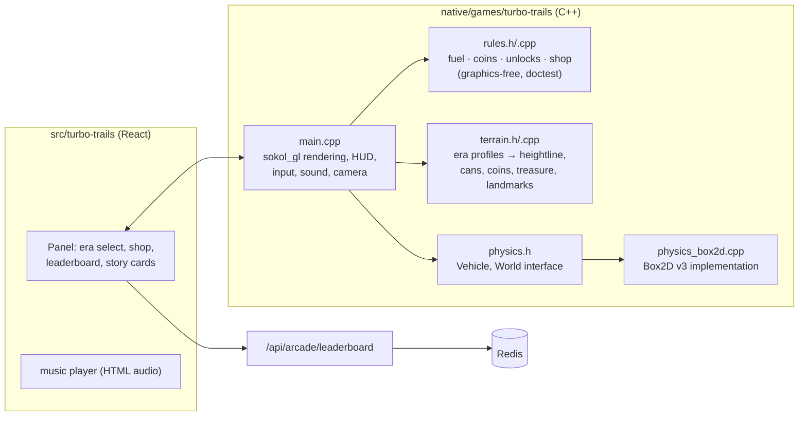

# Turbo Trails: plan

A Hill Climb Racing–style driving game for the Arcade, built from the design in the ClickUp list ("Roads
Through Time") and the mechanics of the earlier Unity prototype (`xlibraries/funny-Racing`). You play
**JyotiRath**, a vehicle that travels the history of transport: ten eras, each with its own vehicle,
landscape, landmarks and music.

## The ten eras

| # | Era | Vehicle | Feel |
| --- | --- | --- | --- |
| 1 | 2000 BCE, India | Chariot | Light, bouncy; Mohenjo-Daro and the Great Bath on the horizon |
| 2 | 1769, England | Steam carriage | Heavy, slow to spin up, huge torque; green hills, mills |
| 3 | 1830, France | Horse-drawn carriage | Tall, tips easily; vineyards, châteaux |
| 4 | 1885, Germany | Vintage car (Motorwagen) | Thin wheels, modest power; timber towns |
| 5 | 1903, USA | Motorcycle | Two wheels, wheelies; plains, oil derricks |
| 6 | 1911, France | Racing car | Fast, low, fragile on bumps; Le Mans straights |
| 7 | 1935, USA | Off-road 4×4 | Big tyres, four-wheel drive; canyons |
| 8 | 1950, Italy | Sports car | Quick and grippy; coast road, cypresses |
| 9 | 1996, USA | Electric car | Instant torque, battery instead of fuel; night city |
| 10 | 2025, Japan | Hover vehicle | Floats on a cushion, no wheels; neon Tokyo |

An era unlocks when you've driven a set distance in the one before (the "level bifurcations"). Each era's
terrain is generated from a seed, so every run is different but the character stays: India is gentle hills,
the USA canyons are steep, Japan is smooth.

## Mechanics (from the prototype, kept as-is unless noted)

- **Controls**: gas and brake/reverse (→/←, A/D, touch halves of the screen, gamepad triggers); in the air
  the same keys tilt the vehicle. Mouse/touch: right half gas, left half brake.
- **Fuel**: a tank that drains while the motor runs; fuel cans on the road refill it. Out of fuel or landing
  on the roof = run over, coins banked.
- **Coins**: 10 per 100 m, 50 per flip, 100 per hidden collectible (one "treasure" per era, off the main
  line), plus coins scattered on the road.
- **Shop**: Engine, Suspension, Tyres and Chassis, four tiers each (300 / 400 / 550 / 750 coins), per era.
- **Landmarks**: as you pass a landmark its name and a one-line fact appear (the "learn and discover" part
  of the brief). Era intro cards tell the story from the ClickUp "Story" task.
- **Physics**: Box2D v3.1.1 (vendored), behind a small interface so it can be replaced by our own engine
  later (issue #37).
- **Audio**: the Chariots background track and wheel loop from the Unity project (your own recordings) for
  era 1, played by the page; synthesized engine, coin and crash sounds from the game for every era.
- **Saving**: coins, upgrades, unlocked eras and best distances on the device. Best distances also go to a
  **global leaderboard** per era (nickname + distance) kept in the site's Redis, read back into the game.

## Architecture

## Phases (one PR each)

| | What you get |
| --- | --- |
| **1. Driving** ✅ | Box2D vendored, the vehicle interface, generated terrain, the chariot driving on era 1 with fuel, coins, flips, crash/out-of-fuel, saved best distance and your music. Native tests for rules and terrain |
| **2. Eras and shop** ✅ | All ten eras with their vehicles, palettes, landmarks and facts; unlocks; the shop with upgrades applied to the physics; story cards |
| **3. Leaderboard and polish** | Global per-era leaderboard (nickname, server-validated distances), gamepad and touch controls, particles, screen shake, sounds per era |
